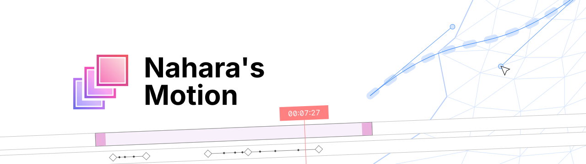

Welcome to the code repository for Nahara's Motion!

Nahara's Motion is a 2D motion graphics software, now armed with proper GPU acceleration, module system, complex
animation system and advanced graphics system.

[![Edit in Nahara's Motion Editor][editor]](https://motion.nahara.io.vn)
[![Powered by Nahara's Motion Engine][engine]](https://nahara.io.vn/software/motion#engine)

## Try Nahara's Motion

This rewrite of Nahara's Motion Editor is not deployed to the web (yet). You will have to clone this repository and run
the app manually. Fortunately, this is an easy task to do.

1. Download Deno 2.9.8
1. Clone this repository
1. Run `deno task --config editor/deno.jsonc dev-desktop`
1. Wait for it to download and build the app, then a new app window will be opened

## What's in the box?

- Advanced animation capability
  - Multiple timelines
  - Keyframe-based or expression-based animation
- Component mechanism ~~stolen directly from ReactJS~~
- Module system, just like your JavaScript
- GPU-accelerated motion graphics (powered by WebGPU)
- ~~A cute cat~~ Okay no we did not include a cat (or did we?)

## Licensing

Nahara's Motion Editor is licensed to you under [General Public License, version 3](./editor/LICENSE) or later version
of GPL. Please read the legal text carefully before you make a fork of the editor.

Nahara's Motion Engine and the supporting libraries are licensed under [MIT license](./motion/LICENSE). In general, you
must keep the copyright notice, but other than that, you can use the engine inside your own apps or games, including the
proprietary ones.

[editor]: ./docs/editor-button.svg
[engine]: ./docs/engine-button.svg
